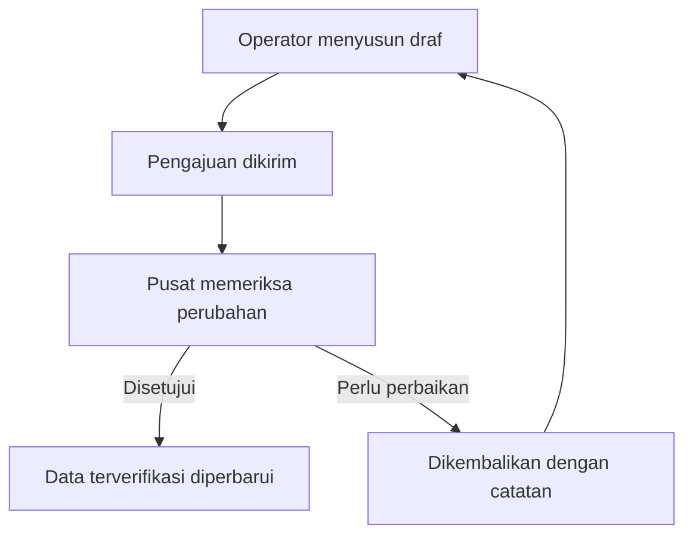

# Brainstorming BINPROFKES — PHP Native dan Database SQL

Tanggal: 23 November 2026  
Versi: 1.0 — hasil diskusi awal  
Tujuan: dasar pengembangan aplikasi administrasi personel dan dashboard pimpinan pada shared hosting/cPanel.  
Acuan tampilan dan fungsi: [binprof.puskesau.com](https://binprof.puskesau.com/).

Dokumen ini merangkum keputusan pengguna dan usulan implementasi. Rincian teknis di bawah merupakan rancangan untuk pembangunan berikutnya. Berkas aplikasi PHP dan SQL yang dapat diimpor belum dibuat dalam tahap brainstorming ini. Pemeriksaan langsung terhadap halaman internal situs referensi belum dilakukan dalam sesi ini.

## 1. Keputusan yang sudah ditetapkan

| Aspek | Keputusan pengguna |
|---|---|
| Teknologi | PHP native dengan keamanan aplikasi dan database yang disertai berkas `.sql` |
| Acuan | Aplikasi seperti BINPROF, dengan pengembangan modul personel |
| Kategori personel | Militer dan PNS; kategori lain dapat ditambahkan |
| Pendidikan | Tersedia Dikum dan Dikmil pada riwayat personel |
| Kasus | Disiplin, pelanggaran, dan perkara hukum |
| Penghargaan | Dicatat dalam riwayat personel |
| Pensiun | Perkiraan tanggal pensiun dan pengingat |
| Pengelolaan | Operator tiap satuan mengisi; pusat memverifikasi |
| Halaman utama pimpinan | Peta sebaran satuan dan personel, ringkasan angka, serta pengingat penting |
| Pemasangan | Shared hosting/cPanel pada subdomain milik pengguna |
| Hasil brainstorming | Berkas `brainstorming.md` |

## 2. Gagasan utama aplikasi

Satu personel memiliki satu profil yang menyatukan identitas, kedinasan, pendidikan, penghargaan, catatan kasus sesuai izin, dan perkiraan pensiun. Setiap jenis riwayat dapat berisi beberapa catatan dan dokumen pendukung.

Operator bekerja pada personel dalam cakupan satuannya. Pusat memverifikasi pengajuan. Pimpinan mendapatkan ringkasan data terverifikasi melalui peta, angka, dan pengingat yang dapat dibuka menjadi daftar personel sesuai kewenangannya.

Usulan sasaran versi pertama:

1. Mengurangi pengisian berulang dan pencarian dokumen secara manual.
2. Membuat data pendidikan dan karier mudah dicari lintas satuan sesuai izin.
3. Menampilkan perubahan yang menunggu verifikasi dan catatan perbaikannya.
4. Membantu pimpinan melihat distribusi personel dan potensi kebutuhan pengganti menjelang pensiun.
5. Menjaga akses catatan kasus melalui kewenangan tersendiri.

## 3. Susunan menu dan pengalaman pengguna

| Menu | Fungsi utama |
|---|---|
| Dashboard Pimpinan | Peta, ringkasan angka, pengingat pensiun, dan pengajuan yang perlu ditindaklanjuti |
| Personel | Daftar, pencarian, filter, tambah, perubahan, detail, dan arsip sesuai izin |
| Pendidikan | Rekap Dikum dan Dikmil lintas personel; menggunakan riwayat yang sama dengan profil |
| Penghargaan | Rekap penghargaan dan penerima |
| Kasus | Daftar kasus dan perkembangan; hanya muncul bagi pengguna yang diberi izin |
| Perkiraan Pensiun | Daftar tanggal perkiraan, dasar perhitungan, sisa waktu, dan pengingat |
| Verifikasi | Antrean pengajuan, perbandingan perubahan, persetujuan, dan pengembalian |
| Dokumen | Pencarian dokumen yang sudah lolos pemeriksaan hak akses |
| Notifikasi | Pengingat dan hasil verifikasi |
| Master Data | Kategori personel, satuan, pangkat/golongan, profesi, pendidikan, dan penghargaan |
| Pengguna dan Hak Akses | Akun, peran, cakupan satuan, serta izin khusus |
| Aktivitas dan Pengaturan | Riwayat aktivitas, konfigurasi aplikasi, dan status tugas terjadwal |

Profil personel diusulkan memiliki tab: **Ringkasan**, **Identitas**, **Kedinasan**, **Dikum**, **Dikmil**, **Penghargaan**, **Kasus**, **Perkiraan Pensiun**, serta **Dokumen dan Riwayat Perubahan**. Tab kasus ditampilkan setelah pemeriksaan izin khusus.

Tampilan memakai bahasa Indonesia, sidebar desktop, navigasi mobile, filter yang dapat direset, tabel dengan pagination, dan formulir yang menampilkan kesalahan pada kolom terkait. Keadaan kosong, proses memuat, kegagalan, serta data yang belum terverifikasi harus terbaca jelas.

## 4. Profil dan kategori personel

### 4.1 Identitas dan kedinasan

| Kelompok | Rancangan data |
|---|---|
| Identitas bersama | ID internal tetap, kategori, nama, tanggal lahir, foto bila diperlukan |
| Militer | NRP, pangkat, korps, dan data kedinasan yang relevan |
| PNS | NIP, pangkat, golongan ruang, dan data kepegawaian yang relevan |
| Penempatan | Satuan, fasilitas/tempat penugasan bila tersedia, jabatan, tanggal mulai/akhir |
| Profesi | Profesi, bidang keahlian/spesialisasi, serta kualifikasi yang tercatat |
| Kontak | Nomor kontak dan alamat hanya jika dibutuhkan dan sesuai kewenangan |
| Status | Status dinas, status verifikasi, dan tanggal pembaruan terakhir |

NRP/NIP disimpan sebagai teks agar format dan angka nol di depan tetap terjaga. ID internal personel tetap sama ketika pindah satuan, berganti pangkat, atau berubah status. Riwayat penempatan disimpan, bukan ditimpa menjadi satu teks satuan terakhir.

Kategori dan status dinas merupakan data terpisah. Contoh: kategori PNS dengan status aktif; kategori PNS dengan status pensiun. Menambahkan kategori baru dilakukan melalui master data, dengan pengaturan jenis identitas dan kolom yang relevan. Nama kategori baru tidak otomatis menghasilkan aturan pensiun.

### 4.2 Kualitas data

- Tanggal lahir dan informasi dasar perhitungan pensiun dapat berstatus belum lengkap.
- Bedakan **belum diisi**, **tidak ada**, **tidak berlaku**, dan **belum diverifikasi**.
- Data terverifikasi menampilkan waktu dan pemeriksa terakhir.
- Pencarian dan ekspor tetap menggunakan cakupan pengguna yang sama.
- Pengarsipan personel mempertahankan relasi pendidikan, penghargaan, dokumen, dan riwayat lainnya.

## 5. Dikum dan Dikmil

| Modul | Rancangan kolom | Penggunaan |
|---|---|---|
| Dikum | Jenjang, institusi, program studi/jurusan, tanggal/tahun masuk dan lulus, status pendidikan, nomor ijazah, dokumen | Melihat riwayat pendidikan umum dan mencari personel menurut pendidikan |
| Dikmil | Jenis pendidikan, lembaga, angkatan, mulai/selesai, status pendidikan, hasil bila relevan, nomor keputusan/sertifikat, dokumen | Melihat pendidikan yang sudah atau sedang diikuti dan kebutuhan pengembangan |

Satu personel dapat mempunyai banyak catatan pendidikan. Lampiran ijazah atau sertifikat terhubung ke catatan yang tepat. Jenjang atau kategori pendidikan tidak disimpan dalam satu kolom teks panjang pada profil.

Usulan filter: satuan, kategori personel, jenis/jenjang pendidikan, program studi, lembaga, tahun, dan status pendidikan. Kesesuaian Dikmil pada kategori tertentu diatur melalui konfigurasi; data yang tidak relevan dapat berstatus tidak berlaku.

Rekap pendidikan dan tab profil membaca sumber data yang sama. Pengguna tidak perlu mengisi pendidikan dua kali.

## 6. Disiplin, pelanggaran, dan perkara hukum

### 6.1 Rancangan pencatatan

| Bagian | Rincian |
|---|---|
| Identitas kasus | ID kasus, kategori, nomor laporan/perkara, tanggal, judul singkat |
| Pihak terkait | Personel terkait dan perannya berdasarkan informasi yang dicatat |
| Penanganan | Unit/pejabat penanggung jawab, tahapan, tindak lanjut, tanggal pembaruan |
| Perkembangan | Kronologi dan catatan peristiwa yang disusun menurut waktu |
| Keputusan | Hasil atau keputusan resmi beserta dasar dokumennya bila tersedia |
| Dokumen | Lampiran laporan, surat, petikan, keputusan, atau dokumen pendukung sesuai kebutuhan |
| Pengendalian | Petugas yang boleh mengakses dan jejak aktivitas |

Status laporan, pemeriksaan, keputusan, dan selesai dibedakan. Tahapan rinci dapat disesuaikan dengan prosedur instansi. Penyelesaian kasus memerlukan pencatatan hasil yang jelas; aplikasi tidak menetapkan kesalahan atau sanksi secara otomatis.

Satu kasus dapat terkait dengan beberapa personel. Rancangan relasi harus menghindari penyalinan satu kasus menjadi beberapa kasus yang berbeda. Hak akses kasus lintas satuan tetap memerlukan penugasan eksplisit.

### 6.2 Usulan pembatasan akses

- Hak mengelola personel umum tidak otomatis memberikan hak membuka kasus.
- Petugas dan verifikator kasus ditetapkan khusus menurut kebutuhan penugasan.
- Izin membaca, mengubah, memverifikasi, mengunduh, dan mengekspor dibuat terpisah.
- Nama kasus dan kronologi tidak dimasukkan ke marker peta, notifikasi umum, atau log teknis mentah.
- Akses baca kasus, pengunduhan, ekspor, dan perubahan dicatat.
- Perubahan hasil atau keputusan mempertahankan riwayat koreksi yang dapat ditelusuri oleh pihak berwenang.

## 7. Penghargaan

Usulan data: jenis/nama penghargaan, tingkat, instansi pemberi, tanggal, nomor keputusan, uraian singkat, personel penerima, dan lampiran.

Fitur awal mencakup beberapa penghargaan per personel, pemeriksaan potensi duplikasi, verifikasi dokumen, pencarian penerima, dan rekap menurut satuan atau periode. Alur pencatatan memakai mekanisme pengajuan dan verifikasi yang sama dengan riwayat personel.

## 8. Perkiraan pensiun dan pengingat

### 8.1 Cakupan yang dipilih

Modul berfokus pada tanggal perkiraan pensiun, sisa masa dinas, daftar personel yang mendekati pensiun, dan pengingat. Checklist pengajuan pensiun serta alur administrasi keputusan pensiun lengkap belum menjadi kebutuhan versi pertama.

Tanggal perkiraan harus diberi label **Perkiraan**. Lewatnya tanggal tersebut tidak otomatis mengubah status personel menjadi pensiun atau mengarsipkannya.

### 8.2 Usulan cara menentukan tanggal

Cara perhitungan belum dipilih pengguna. Rancangan mendukung dua sumber:

1. **Tanggal yang diinput dan diverifikasi pusat**, disertai sumber atau alasan.
2. **Perhitungan berdasarkan aturan yang telah diverifikasi**, memakai kategori dan atribut yang memang diperlukan aturan tersebut.

Usulan operasional: mulai dengan tanggal yang dapat diverifikasi, kemudian aktifkan perhitungan otomatis setelah dasar aturan tersedia. Aturan mempunyai referensi, tanggal berlaku, versi, dan pemeriksa. Angka usia pensiun Militer/PNS belum ditetapkan dalam dokumen ini.

Data pendukung rancangan: tanggal perkiraan, metode penentuan, dasar/referensi, versi aturan bila digunakan, waktu perhitungan, pemeriksa, dan status kelengkapan data. Jika dasar perhitungan belum cukup, tampilkan **Belum dapat dihitung**. Perubahan tanggal lahir atau atribut yang memengaruhi aturan memicu pemeriksaan ulang perkiraan.

### 8.3 Pengingat

- Usulan awal tenggat: 12, 6, 3, dan 1 bulan; nilainya dapat diubah dan belum menjadi pilihan tetap pengguna.
- Kanal awal yang diusulkan: notifikasi dalam aplikasi dan panel dashboard. Email/WhatsApp dapat dibahas terpisah bila diperlukan.
- Penerima mengikuti cakupan satuan dan kewenangan, termasuk operator satuan serta pusat yang ditugaskan.
- Setiap tenggat mengirim satu pengingat per versi perkiraan dan penerima; pemuatan ulang halaman tidak menggandakannya.
- Perubahan perkiraan memperbarui jadwal dan menandai pengingat lama yang sudah tidak relevan.
- Penghitungan bulan memakai kalender; tanggal kalender disimpan sebagai `DATE`.
- Perkiraan yang sudah terlewati ditandai perlu konfirmasi, tanpa menetapkan status dinas resmi.

Pengingat otomatis diusulkan berjalan melalui cron cPanel sekali sehari. Tugas mencatat hasil dan menggunakan penguncian agar proses tidak tumpang tindih. Jika cron tidak tersedia, pemeriksaan saat halaman dibuka dapat menjadi alternatif terbatas; pengingat di luar waktu penggunaan memerlukan penjadwalan yang berfungsi.

## 9. Peta dan dashboard pimpinan

### 9.1 Isi layar utama

| Area | Rancangan |
|---|---|
| Ringkasan atas | Jumlah personel aktif terverifikasi, Militer, PNS, satuan dalam cakupan, dan personel mendekati pensiun |
| Peta utama | Marker lokasi satuan atau tempat penugasan yang tercatat |
| Panel satuan | Ringkasan personel, profesi, pendidikan, dan perkiraan pensiun dari satuan yang dipilih |
| Filter | Satuan/komando jika tersedia, kategori personel, profesi, pangkat/golongan, Dikum, dan Dikmil |
| Pengingat | Perkiraan pensiun terdekat dan pengajuan menunggu tindakan sesuai peran |
| Tabel pendamping | Daftar hasil yang sinkron dengan filter peta |

Peta menggunakan lokasi satuan/penugasan, bukan alamat rumah atau pelacakan posisi langsung personel. Koordinat dan hierarki satuan berasal dari data yang telah disetujui. Satuan tanpa koordinat tetap tersedia di tabel dengan status lokasi belum lengkap.

### 9.2 Interaksi yang diusulkan

1. Klik marker membuka ringkasan satuan dan tombol melihat personel yang berwenang diakses.
2. Marker berdekatan dapat dikelompokkan; pencarian dapat memfokuskan lokasi.
3. Filter, ringkasan angka, marker, dan tabel berubah secara konsisten.
4. Tombol layar penuh, reset filter, legenda, dan penyesuaian cakupan peta tersedia.
5. Tabel tetap dapat dipakai jika peta gagal dimuat.
6. Jumlah personel dihitung unik; beberapa pendidikan tidak menambah jumlah orang.
7. Setiap angka menampilkan arti populasi dan waktu pembaruan; data yang belum terverifikasi mempunyai indikator tersendiri.

Usulan pustaka: peta 2D Leaflet, dengan aset aplikasi lokal dan versi yang dipilih saat implementasi. Penyedia basemap mengikuti lisensi serta ketentuan layanan. Alternatif peta lokal harus menggunakan data berlisensi dan tidak dibuat dengan mengunduh massal tile publik.

Penghitungan agregat dilakukan setelah pemeriksaan cakupan pengguna. Respons peta hanya membawa data yang diperlukan. Cache dibedakan menurut cakupan dan izin. Pengguna tanpa hak kasus tidak menerima angka/detail kasus melalui respons peta atau grafik.

## 10. Pengajuan dan verifikasi pusat

Rancangan status: **Draf**, **Diajukan**, **Dikembalikan**, **Disetujui**, dan **Dibatalkan**. Setiap keputusan menyimpan pengguna, waktu, serta catatan yang relevan.

Usulan aturan kerja:

- Operator hanya mengubah data dalam cakupan satuan yang sedang berlaku.
- Draf baru yang belum disetujui tidak dihitung sebagai data terverifikasi pada dashboard.
- Pembaruan yang menunggu pemeriksaan mempertahankan versi terverifikasi sebelumnya.
- Verifikator melihat perbandingan data sebelum dan sesudah perubahan, termasuk lampiran terkait.
- Pemohon tidak dapat menyetujui pengajuannya sendiri, termasuk ketika mempunyai beberapa peran.
- Persetujuan memeriksa ulang versi data, kewenangan terkini, dan cakupan satuan dalam transaksi database.
- Pengajuan yang berbenturan dengan perubahan lain ditandai untuk diperiksa ulang.
- Perpindahan satuan memperbarui penempatan dan riwayat secara konsisten; hak akses lama dievaluasi ulang.
- Pengajuan dokumen kasus hanya masuk antrean verifikator yang memiliki izin kasus.

## 11. Usulan peran dan hak akses

| Peran | Hak awal yang diusulkan | Cakupan |
|---|---|---|
| Administrator Sistem | Akun, peran, konfigurasi, dan master data | Administrasi sistem; akses isi kasus memerlukan penugasan khusus |
| Operator Satuan | Input, draf, pengajuan, perbaikan, dan lihat hasil verifikasi | Satuan yang ditugaskan |
| Verifikator Pusat | Pemeriksaan dan keputusan pengajuan | Satuan/modul yang ditugaskan |
| Pimpinan | Peta, ringkasan, daftar, serta laporan sesuai izin | Wilayah/satuan yang ditetapkan |
| Petugas Kasus | Pencatatan dan tindak lanjut kasus | Kasus yang secara eksplisit ditugaskan |
| Verifikator Kasus | Pemeriksaan catatan/dokumen kasus | Kasus yang ditugaskan; tidak menyetujui pengajuan sendiri |

Peran menentukan tindakan yang boleh dilakukan; cakupan menentukan data yang boleh dijangkau. Izin kasus, unduh, dan ekspor diberikan tersendiri. Pengguna tidak dapat memberikan izin sensitif kepada dirinya sendiri. Penetapan pejabat pemberi izin awal memerlukan prosedur administrasi yang terdokumentasi.

## 12. Keamanan yang perlu diwujudkan

### 12.1 Login dan permintaan aplikasi

- Login dan otorisasi ditangani server. Hindari akses cepat/bypass pada produksi.
- Password menggunakan `password_hash()` dan pemeriksaan `password_verify()`; tidak disimpan sebagai teks asli.
- Sesi memakai cookie `Secure`, `HttpOnly`, dan `SameSite`, regenerasi ID saat login, serta batas waktu di server.
- HTTPS diaktifkan. Perubahan izin atau penonaktifan akun harus berlaku pada sesi yang sedang berjalan.
- Pembatasan percobaan login dan autentikasi tambahan untuk akun berwenang tinggi disiapkan sesuai kemampuan instalasi.
- Permintaan yang mengubah data memakai perlindungan CSRF. Tampilan teks dan masukan diproses sesuai konteks untuk mencegah XSS.
- Query memakai PDO prepared statements. Nama kolom pengurutan dan bagian query yang tidak dapat di-bind dibatasi dengan allowlist.
- Hak akses diperiksa pada setiap halaman, endpoint, dokumen, cetak, dan ekspor. Mengubah ID permintaan tidak boleh membuka data satuan lain.

### 12.2 Dokumen

Usulan format awal: PDF, JPG, dan PNG, dengan batas awal 5 MB per berkas yang masih perlu disesuaikan dengan hosting. Validasi mencakup ukuran, ekstensi, MIME, dan isi sesuai format. Nama penyimpanan dibuat aplikasi; berkas disimpan di luar document root dan tidak dapat dieksekusi. Unduh melalui pemeriksaan izin. Pemindaian tambahan digunakan bila tersedia; status pemeriksaan tidak boleh diklaim melebihi pemeriksaan yang dilakukan.

### 12.3 Data dan aktivitas

- Konfigurasi, kunci aplikasi, SQL, log, sesi, ekspor, dan cadangan berada di luar area publik.
- Akun database aplikasi memakai hak yang diperlukan. Hak instalasi/migrasi dibedakan dari penggunaan rutin bila hosting memungkinkan.
- Data identitas sensitif dan isi kasus ditentukan klasifikasi serta kebutuhan enkripsinya saat implementasi; kunci dipisahkan dari database/cadangan.
- Log aktivitas mencatat tindakan, objek, pelaku, waktu, serta hasil tanpa menyalin password, token, atau kronologi kasus mentah.
- Pembukaan kasus, pengunduhan, ekspor, dan persetujuan tercatat. Aplikasi tidak menyediakan penghapusan audit melalui menu biasa.
- Cadangan database dan dokumen dilindungi, mempunyai masa simpan, dan diuji pemulihannya. Perlindungan audit pada shared hosting mempunyai batas terhadap pemilik akun/server; kebutuhan bukti yang lebih kuat memerlukan salinan di lokasi terpisah.
- Ekspor mengikuti izin dan filter, memakai kolom yang diizinkan, serta menangani formula berbahaya pada keluaran spreadsheet.

## 13. Rancangan database dan berkas .sql

Bagian ini adalah rancangan logis untuk penyusunan `binprofkes.sql`, bukan database situs referensi. Tabel akhir dan tipe datanya perlu ditetapkan serta diuji pada mesin MySQL/MariaDB yang benar-benar dipakai hosting.

| Kelompok | Usulan tabel | Kegunaan |
|---|---|---|
| Master personel | `personnel_categories`, `ranks`, `professions` | Kategori yang dapat ditambah dan referensi profil |
| Organisasi | `units`, `facilities` | Hierarki, penugasan, dan lokasi satuan/fasilitas bila diperlukan |
| Personel | `personnel`, `personnel_identifiers` | Profil stabil dan nomor kedinasan menurut jenis identitas |
| Penempatan | `service_assignments` | Riwayat satuan dan jabatan |
| Pendidikan | `dikum_histories`, `dikmil_histories` | Banyak riwayat per personel |
| Penghargaan | `award_types`, `personnel_awards` | Master dan riwayat penghargaan |
| Kasus | `disciplinary_cases`, `case_personnel`, `case_events` | Kasus, pihak terkait, dan perkembangan |
| Izin kasus | `case_access_grants` | Penugasan spesifik beserta tindakan yang diizinkan |
| Dokumen | `documents` dan tabel penghubung per modul | Metadata, lokasi penyimpanan privat, versi, dan relasi dokumen |
| Perkiraan pensiun | `retirement_rules`, `retirement_forecasts` | Dasar aturan bila digunakan, versi, dan hasil perkiraan |
| Pengingat | `notification_rules`, `notifications`, `notification_recipients` | Tenggat, pesan, penerima, serta status baca/kirim |
| Akun dan peran | `users`, `roles`, `permissions`, `user_roles`, `role_permissions` | Autentikasi dan tindakan yang diizinkan |
| Cakupan | `user_unit_scopes` | Satuan yang boleh dijangkau pengguna |
| Verifikasi | `change_requests`, `approval_actions` | Usulan perubahan dan keputusan pemeriksaan |
| Operasional | `audit_logs`, `job_runs`, `app_settings`, `schema_migrations` | Aktivitas, tugas terjadwal, konfigurasi, dan versi skema |

Relasi pendidikan/penghargaan dengan personel bersifat satu ke banyak. Relasi kasus dengan personel menggunakan tabel penghubung. Dokumen memakai penghubung ber-foreign key untuk tiap modul, misalnya `dikum_documents`, `dikmil_documents`, `award_documents`, dan `case_documents`, agar kepemilikan lampiran dapat divalidasi.

Usulan aturan SQL:

1. Gunakan InnoDB, `utf8mb4`, foreign key, dan indeks sesuai query serta kompatibilitas hosting.
2. Nomor identitas mempunyai aturan unik per jenis identitas; jangan menggunakan nilai contoh yang sama untuk data kosong.
3. Indeks mendukung pencarian satuan/kategori/status, antrean verifikasi, kasus yang ditugaskan, dan tanggal perkiraan pensiun.
4. `DATE` dipakai untuk tanggal kalender; waktu aktivitas memakai standar penyimpanan konsisten dan ditampilkan menurut zona waktu aplikasi.
5. Persetujuan, mutasi, pembaruan perkiraan, dan pengingat memakai transaksi serta pengendalian versi yang sesuai.
6. Pengarsipan tidak menghapus riwayat terkait secara otomatis melalui cascade.
7. Berkas awal mengisi master Militer/PNS dan peran/izin dasar. Data uji sintetis dipisahkan dari seed produksi.
8. Akun administrator pertama dibuat melalui prosedur bootstrap satu kali, bukan password universal di dalam `.sql`.
9. Berkas instalasi baru dan migrasi pembaruan dibedakan; pembaruan tidak boleh diawali penghapusan database yang sudah berisi data.
10. SQL harus benar-benar diimpor dan diperiksa di mesin target sebelum dinyatakan siap; keberhasilan pada satu jenis database tidak membuktikan kompatibilitas semua varian.

## 14. Rancangan pemasangan pada shared hosting/cPanel

### 14.1 Teknologi

Usulan: PHP native dengan pemisahan controller, service, repository, policy, dan view; MySQL/MariaDB; HTML/CSS dan JavaScript seperlunya; aset peta/grafik dipaketkan bersama aplikasi.

Pilih cabang PHP yang masih didukung dan tersedia pada hosting. Target kompatibilitas awal dapat memakai PHP 8.4/8.5 dengan patch yang dipelihara penyedia; versi akhir dan ekstensi harus diperiksa pada akun sebenarnya. Mesin database, kuota, batas upload, akses cron, dan kemampuan mengatur document root juga perlu dicatat.

Hosting tidak perlu menjalankan Node.js, daemon, atau proses build. Dependency tambahan dapat disiapkan secara lokal dan disertakan dalam paket. Bila routing bersih tidak tersedia, aplikasi menyiapkan fallback melalui front controller.

### 14.2 Penempatan berkas

**Pilihan A, bila penyedia mengizinkan document root khusus:** satu folder proyek berisi `public/`, `app/`, `config/`, `database/`, `storage/`, `vendor/`, dan `tools/`. Subdomain diarahkan hanya ke `public/`; seluruh folder privat berada di luar webroot semua domain pada akun.

**Pilihan B, bila document root dibatasi di bawah `public_html`:** hanya front controller dan aset publik diletakkan di direktori subdomain. `app`, konfigurasi, SQL, penyimpanan, dan dependency privat diletakkan di direktori terpisah di luar `public_html`.

Kemampuan cPanel bergantung pada pengaturan penyedia. Penempatan privat harus diperiksa terhadap akses melalui subdomain maupun domain utama. Aturan `.htaccess` menjadi perlindungan tambahan pada server yang mendukungnya, bukan alasan untuk membiarkan SQL dan konfigurasi tersedia sebagai berkas publik.

### 14.3 Langkah instalasi yang perlu disiapkan

1. Tentukan subdomain dan document root yang tersedia.
2. Periksa PHP, ekstensi seperti PDO MySQL/Fileinfo, mesin database, HTTPS, dan kuota.
3. Buat database serta akun yang sesuai, lalu impor SQL melalui fasilitas hosting.
4. Isi konfigurasi lokal di lokasi privat; jangan memasukkan kredensial ke repositori atau dokumen panduan.
5. Jalankan bootstrap administrator sekali, kemudian nonaktifkan installer.
6. Konfigurasikan cron pengingat dan zona waktu operasional.
7. Periksa perlindungan direktori, cakupan akun, akses lampiran, dan alur persetujuan.
8. Atur cadangan dan lakukan uji pemulihan pada lingkungan terpisah.

## 15. Prioritas pembangunan

| Tahap | Hasil yang diharapkan |
|---|---|
| 1 — Fondasi | Skema SQL, login, peran/cakupan, master kategori dan satuan, profil personel, pengajuan/verifikasi, dan audit dasar |
| 2 — Riwayat | Dikum, Dikmil, penghargaan, kasus dengan izin khusus, serta dokumen privat |
| 3 — Pimpinan | Peta dan filter, agregat terverifikasi, perkiraan pensiun, notifikasi, dan cron |
| 4 — Kesiapan pemasangan | Pengujian database target, pemasangan cPanel, ekspor terotorisasi, backup/restore, serta panduan operator dan verifikator |

Peta awal dan rancangan antarmuka dapat diperlihatkan lebih dini dengan data sintetis. Angka operasional baru berasal dari data yang sudah melewati alur verifikasi.

## 16. Contoh penerimaan hasil implementasi

| Skenario | Hasil yang harus diperiksa |
|---|---|
| Operator satuan A mencoba membuka personel satuan B lewat perubahan URL | Permintaan ditolak oleh server |
| Operator memperbarui Dikum dan mengajukan verifikasi | Perubahan tercatat; data terverifikasi sebelumnya tetap digunakan sampai disetujui |
| Pemohon memiliki peran verifikator | Tetap tidak dapat menyetujui pengajuannya sendiri |
| Dua verifikator memproses perubahan yang sama | Satu keputusan konsisten diterapkan; benturan ditangani |
| Personel memiliki beberapa Dikum/Dikmil | Jumlah orang pada peta tetap dihitung satu |
| Pengguna tanpa izin kasus mencoba membuka atau mengunduh lampirannya | Akses ditolak tanpa membocorkan isi kasus |
| Kategori personel baru ditambahkan | Profil dapat memakai kategori tersebut; aturan pensiun memerlukan konfigurasi tersendiri |
| Dasar perhitungan pensiun belum lengkap | Aplikasi menampilkan belum dapat dihitung, tanpa tanggal hasil tebakan |
| Cron dijalankan ulang atau halaman dimuat berulang kali | Tidak menimbulkan pengingat duplikat untuk tenggat yang sama |
| Pengguna mengakses lokasi SQL/upload secara langsung | Berkas privat tidak dapat diunduh dari URL publik |
| Peta atau penyedia basemap gagal dimuat | Tabel dan ringkasan yang berwenang tetap dapat dipakai |
| SQL diimpor serta cadangan dipulihkan pada mesin target | Tabel, relasi, data, dan dokumen terkait tetap konsisten |

## 17. Rincian yang masih perlu ditentukan

Keputusan pada bagian 1 sudah berasal dari pilihan pengguna. Hal berikut dapat diselesaikan saat menyiapkan implementasi tanpa mengubah arah utama:

| Rincian | Usulan awal atau kebutuhan verifikasi |
|---|---|
| Nama subdomain final dan aset identitas | Gunakan nama serta logo/aset yang diberikan pengguna |
| PHP/database dan batas hosting | Periksa langsung kemampuan akun cPanel sebelum menetapkan kompatibilitas |
| Sumber tanggal perkiraan pensiun | Input terverifikasi terlebih dahulu atau rumus setelah dasar aturan diverifikasi; metode akhir belum dipilih |
| Tenggat dan kanal pengingat | Usulan 12/6/3/1 bulan melalui aplikasi; dapat diubah |
| Petugas/verifikator kasus | Tentukan penugasan dan pejabat pemberi izin |
| Hierarki serta koordinat satuan | Gunakan master dan lokasi yang sudah disetujui |
| Basemap | Pilih sumber berlisensi yang sesuai penggunaan dan kebutuhan koneksi |
| Lampiran, kuota, retensi, dan backup | Tetapkan batas aktual menurut kebutuhan instansi serta kemampuan hosting |
| Impor data lama | Periksa struktur sumber, pemetaan kolom, duplikasi, dan kewenangan sebelum mengimpor |
| Fitur BINPROF lain | Inventarisasi terpisah jika dibutuhkan; fitur klinis, chatbot, dan integrasi eksternal belum menjadi keputusan diskusi ini |

## 18. Bentuk paket implementasi berikutnya

Hasil pengembangan yang disarankan: kode PHP native lengkap, aset lokal, `binprofkes.sql`, migrasi pembaruan, contoh konfigurasi tanpa rahasia, skrip pengingat untuk cron, serta panduan pemasangan dan pengoperasian. Sertakan catatan versi yang benar-benar diuji dan hasil pengujian hak akses. Data demo, bila disediakan, diberi label sintetis dan dipisahkan dari produksi.

Dokumen ini dapat digunakan sebagai dasar menyusun prompt implementasi atau spesifikasi pekerjaan. Pembangunan aplikasi dan pemasangan ke server merupakan tahap berikutnya.

## 19. Referensi teknis

Referensi diperiksa pada 23 November 2026. Tautan mendasari pilihan teknis; aturan pensiun resmi belum ditetapkan melalui referensi ini.

- [PHP — Supported Versions](https://www.php.net/supported-versions.php): pemilihan cabang PHP yang masih dipelihara.
- [PHP — password_hash](https://www.php.net/manual/en/function.password-hash.php): penyimpanan password melalui hash.
- [PHP — PDO::prepare](https://www.php.net/manual/en/pdo.prepare.php): parameter query dan batas penggunaan placeholder.
- [OWASP — Authorization Cheat Sheet](https://cheatsheetseries.owasp.org/cheatsheets/Authorization_Cheat_Sheet.html): prinsip pemeriksaan hak akses di server.
- [OWASP — File Upload Cheat Sheet](https://cheatsheetseries.owasp.org/cheatsheets/File_Upload_Cheat_Sheet.html): penanganan unggahan dan penyimpanan di luar webroot.
- [cPanel — Cron Jobs](https://docs.cpanel.net/cpanel/advanced/cron-jobs/): tugas pengingat terjadwal.
- [cPanel — Create a New Domain](https://docs.cpanel.net/cpanel/domains/domains/create-a-new-domain/): pengaturan document root dan batas penyedia.
- [Leaflet](https://leafletjs.com/): pustaka peta interaktif.
- [OpenStreetMap Foundation — Tile Usage Policy](https://operations.osmfoundation.org/policies/tiles/): penggunaan tile, atribusi, dan batas layanan.
