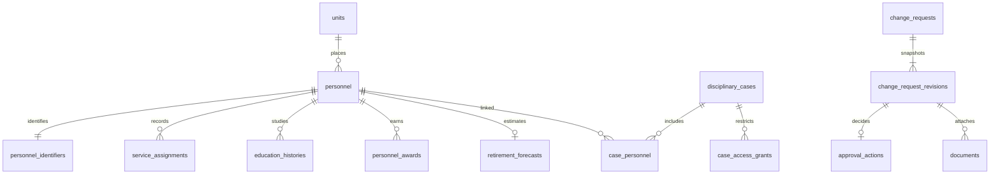

# Kamus data

DDL di [database/binprofkes.sql](../database/binprofkes.sql) mendefinisikan tipe, nullability, indeks, dan constraint lengkap. Tabel memakai InnoDB dan utf8mb4. ID objek utama bertipe INT UNSIGNED, audit bertipe BIGINT UNSIGNED, dan tanggal domain bertipe DATE. Timestamp basis data memakai UTC.

| Entitas | Kunci dan aturan |
|---|---|
| users, roles, user_roles | Username unik. Hash PHP, akun aktif dan versi sesi memutus akses lama. Password diinput lewat formulir HTTPS atau stdin privat. |
| user_unit_scopes, user_verification_modules | Kunci gabungan akun × satuan atau akun × modul. Satuan tidak mewarisi izin. |
| units, facilities | Induk satuan FK ke satuan. Master ditandai nonaktif. Koordinat nullable sebagai pasangan DECIMAL; rentang diperiksa. Fasilitas terikat satuan. |
| personnel_categories, identifier_types, reference_values | Kode kategori dan jenis unik. Master referensi unik per jenis. Kategori memilih jenis nomor dan keberlakuan Dikmil. |
| personnel, personnel_identifiers | ID tetap, versi per profil, unit terkini, dan status dinas terpisah dari kategori. Nomor dipangkas dan dijadikan huruf besar ASCII, dengan angka nol depan tetap. Digest berkunci unik per jenis, cipher untuk pembacaan; tanggal lahir juga terenkripsi. |
| service_assignments | Rentang `[start_on,end_before)`, nilai NULL di ujung kanan berarti penempatan terbuka. Indeks unik generated column membatasi satu penempatan terbuka per personel. Service mengunci profil dan riwayat saat memperbarui interval. |
| education_histories, personnel_awards | FK personel dan tipe master. Pendidikan memakai tanggal atau tahun untuk tiap ujung periode. Nomor sertifikat pendidikan terenkripsi. Pengecekan potensi penghargaan ganda memakai personel, jenis, dan tanggal. |
| disciplinary_cases, case_personnel, case_events | Isi kasus, peran pihak, keputusan, dan snapshot riwayat terenkripsi. FK kasus dan personel menahan integritas relasi banyak ke banyak. Riwayat unik per versi kasus. |
| case_access_grants | Kunci kasus × akun × tindakan. Tanggal habis nullable. Pemberi izin tercatat. |
| change_requests, change_request_revisions, approval_actions | Pengajuan mengikat pemohon, satuan, dan FK objek spesifik. Revisi menyimpan versi dasar dan snapshot sebelum/sesudah terenkripsi. Keputusan maksimal satu per revisi. Status final dan data terbit diubah bersama. |
| documents | FK gabungan ke revisi, kunci penyimpanan acak, MIME, ukuran, SHA-256. Berkas privat dan terenkripsi menggunakan konteks objek. |
| retirement_forecasts, scheduled_service | Perkiraan aktif per personel dengan sumber, tanggal, versi dasar, pemeriksa. Riwayat tetap tersedia pada revisi. Mutasi terjadwal memiliki satu baris per pengajuan dan status penerapan. |
| notifications, app_settings | Notifikasi per penerima, status baca sendiri, dan deduplikasi unik dari objek/versi/jenis/penerima. Pengingat yang sudah tergantikan disembunyikan melalui pemeriksaan versi. |
| login_limits, audit_logs, job_locks, job_runs, schema_migrations | Pembatas percobaan memakai digest berkunci. Audit menyimpan aktor, tindakan, objek dan ID permintaan. Lease memakai token dan kedaluwarsa. Pencatatan job tidak memuat data kasus. |

Enkripsi menggunakan Sodium XChaCha20-Poly1305. Envelope menyimpan versi kunci. Digest nomor kedinasan menggunakan kunci terpisah. Keyring berada di direktori privat, terpisah dari basis data. ID relasional, indeks akses, nama, dan atribut filter tetap tersedia bagi database. Retensi ditetapkan instansi bersama pengelola data.

Migrasi 003 menambah `documents.detached_at`. Lampiran yang dilepas saat draf tetap tersimpan untuk audit dan pemulihan. Daftar, unduh, dan penerbitan normal hanya memakai lampiran dengan nilai `NULL`.

Migrasi 004 menambah `staffing_targets` dengan satu target per satuan, bulan, dan nama jabatan. Kolom `period` selalu menyimpan tanggal pertama bulan. Tabel `import_batches` menyimpan token acak, pembuat dan jumlah draf untuk percobaan ulang yang aman. Pratinjau yang valid disimpan terenkripsi sementara di sesi privat operator.
